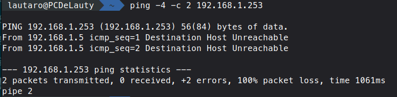
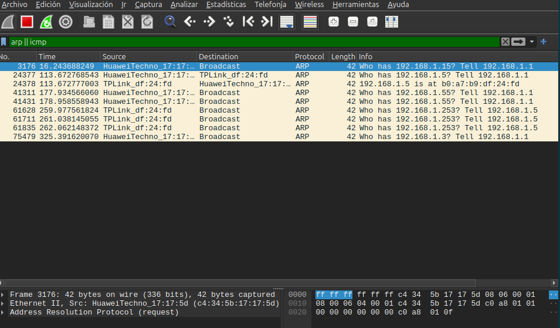
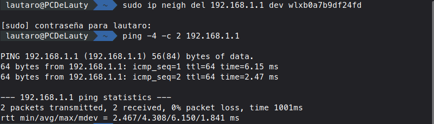
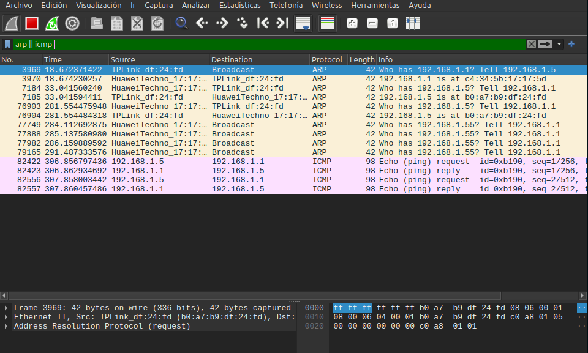
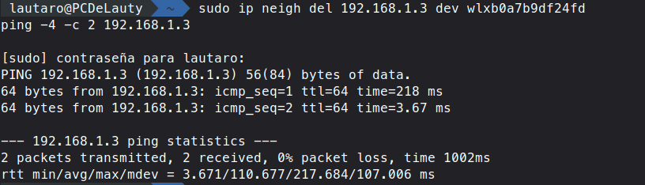
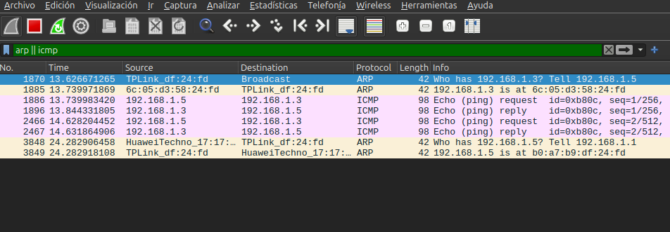

# Punto 2 - Inciso f: Generación y Captura de Tráfico ARP

En este punto se capturó tráfico en la interfaz de red inalámbrica (`wlxb0a7b9df24fd`) utilizando Wireshark con el filtro de visualización:
```text
arp || icmp
```

Dado que las entradas ARP permanecen guardadas temporalmente en la memoria caché del sistema operativo, se utilizaron diferentes métodos para forzar la emisión y captura de paquetes ARP.

---

## 1. Generación de tráfico ARP

### Opción A: Ping a una IP inexistente de la misma subred (192.168.1.253)

Se ejecutó una prueba de conectividad hacia una dirección IP que no está asignada a ningún dispositivo dentro de la red local:

```bash
ping -4 -c 2 192.168.1.253
```

**Resultado en la terminal:**


Como se observa, el sistema operativo intentó resolver la dirección física del destino y, al no obtener respuesta, devolvió el error `Destination Host Unreachable` con un 100% de pérdida de paquetes.

**Captura en Wireshark:**


**Análisis de la captura:**
- El equipo emisor (`TPLink_df:24:fd` / `192.168.1.5`) generó exactamente **3 solicitudes consecutivas de ARP Request** en modo difusión (*broadcast*) preguntando:  
  *«Who has 192.168.1.253? Tell 192.168.1.5»* (Tramas 61628, 61711 y 61835).
- **No se registró ningún ARP Reply**, ya que ningún dispositivo en la LAN posee dicha dirección IP asignada.
- **No se transmitió ningún paquete ICMP Echo Request** por la red física. Debido a que el sistema operativo no logró resolver la dirección MAC de destino mediante ARP, la capa de enlace no pudo encapsular la trama Ethernet y el datagrama IP fue descartado localmente.

---

### Opción B: Eliminación de la entrada del gateway en la caché y ping al router

Para observar un ciclo completo de resolución de direcciones (Request y Reply exitosos), se eliminó la entrada del router de la caché ARP local y posteriormente se realizó un ping hacia el gateway:

```bash
sudo ip neigh del 192.168.1.1 dev wlxb0a7b9df24fd
ping -4 -c 2 192.168.1.1
```

**Resultado en la terminal:**


El comando ping respondió de forma exitosa (2 paquetes transmitidos, 2 recibidos, 0% de pérdida de paquetes y tiempos de respuesta de 2 a 6 ms).

**Captura en Wireshark:**


**Análisis de la captura:**
- Inmediatamente después de vaciar la entrada del gateway con `ip neigh del`, el sistema operativo generó un **ARP Request** en difusión (*broadcast*) a la dirección `ff:ff:ff:ff:ff:ff` preguntando por la MAC del router:  
  *«Who has 192.168.1.1? Tell 192.168.1.5»* (Trama 3969).
- El router respondió inmediatamente con un **ARP Reply** en modo monodifusión (*unicast*) directo a la MAC de la PC:  
  *«192.168.1.1 is at c4:34:5b:17:17:5d»* (Trama 3970).
- Una vez actualizada la caché ARP, los paquetes de ping (**ICMP Echo Request** y **ICMP Echo Reply**) se transmitieron con normalidad (Tramas 82422 a 82557) sin requerir nuevas consultas ARP.

---

### Opción C: Comunicación con otro equipo de la LAN (192.168.1.3)

Se realizó una prueba de comunicación directa hacia otro host ubicado dentro de la misma red de área local (en este caso, un dispositivo con dirección IP `192.168.1.3`), eliminando previamente su entrada de la caché para forzar el ciclo ARP:

```bash
sudo ip neigh del 192.168.1.3 dev wlxb0a7b9df24fd
ping -4 -c 2 192.168.1.3
```

**Resultado en la terminal:**


El comando ping respondió exitosamente (2 paquetes transmitidos, 2 recibidos, 0% de pérdida de paquetes).

**Captura en Wireshark:**


**Análisis de la captura:**
- **Resolución directa entre hosts de la LAN:** El equipo emisor (`192.168.1.5` / `TPLink_df:24:fd`) transmitió un **ARP Request** en difusión (*broadcast*) preguntando:  
  *«Who has 192.168.1.3? Tell 192.168.1.5»* (Trama 1870).  
  El host destinatario contestó con un **ARP Reply** en monodifusión (*unicast*) informando su dirección física:  
  *«192.168.1.3 is at 6c:05:d3:58:24:fd»* (Trama 1885).
- **Tráfico directo entre estaciones:** A diferencia de las comunicaciones hacia Internet (donde la MAC de destino es obligatoriamente la del router), en este caso las tramas Ethernet viajan directamente entre las placas de red físicas de ambos equipos (`b0:a7:b9:df:24:fd` y `6c:05:d3:58:24:fd`), actuando el router únicamente como conmutador (*switch*) de capa 2.
- **Impacto de ARP en la latencia (RTT):** En la terminal se evidencia que el primer paquete ICMP tuvo un tiempo de respuesta de **218 ms**, mientras que el segundo paquete tardó solamente **3.67 ms**. Esta marcada diferencia ilustra perfectamente el costo temporal de la resolución: el primer paquete debió esperar a que se complete el intercambio ARP Request/Reply antes de poder ser transmitido, mientras que el segundo se envió inmediatamente consultando la entrada ya aprendida en la caché ARP.

---

## 2. Análisis comparativo: ARP Request vs. ARP Reply

Tomando como referencia las tramas obtenidas en la **Opción B** (Trama 3969 de solicitud y Trama 3970 de respuesta), se completó la siguiente tabla con los valores reales observados en Wireshark:

| Campo | ARP Request (Trama 3969) | ARP Reply (Trama 3970) |
| :--- | :--- | :--- |
| **MAC destino (encabezado Ethernet)** | `ff:ff:ff:ff:ff:ff` (Broadcast) | `b0:a7:b9:df:24:fd` (Unicast a la PC) |
| **MAC origen (encabezado Ethernet)** | `b0:a7:b9:df:24:fd` (PC emisora) | `c4:34:5b:17:17:5d` (Router Huawei) |
| **Opcode** | `1` (*request*) | `2` (*reply*) |
| **Sender MAC address** | `b0:a7:b9:df:24:fd` (PC emisora) | `c4:34:5b:17:17:5d` (Router Huawei) |
| **Sender IP address** | `192.168.1.5` | `192.168.1.1` |
| **Target MAC address** | `00:00:00:00:00:00` | `b0:a7:b9:df:24:fd` (PC consultante) |
| **Target IP address** | `192.168.1.1` (IP consultada) | `192.168.1.5` |

---

## 3. Preguntas de análisis sobre la captura

### a) ¿Por qué el Request va a una dirección broadcast y el Reply no? ¿Qué valor tiene Target MAC address en el Request y por qué?
* **Dirección de destino:** El **ARP Request** debe enviarse obligatoriamente a la dirección de difusión (*broadcast*, `ff:ff:ff:ff:ff:ff`) porque el equipo emisor desconoce totalmente qué placa física posee la IP buscada; la única forma de asegurar que el mensaje llegue al destinatario es transmitiéndolo a todos los hosts de la red local. Por el contrario, el **ARP Reply** se envía en modo monodifusión (*unicast*) porque el host que responde ya conoce la dirección MAC de quien le preguntó (dado que venía incluida en el campo *Sender MAC address* de la solicitud), evitando generar tráfico innecesario para el resto de la red.
* **Target MAC address en el Request:** Tiene el valor `00:00:00:00:00:00` debido a que es justamente la información desconocida que se está intentando averiguar mediante la consulta.

### b) En el encabezado Ethernet de la trama ARP, ¿qué valor tiene el campo Type? ¿Hay un encabezado IP? ¿Qué les dice eso sobre dónde "vive" ARP?
* **Campo Type (EtherType):** Tiene el valor **`0x0806`** (*Address Resolution Protocol*).
* **¿Hay encabezado IP?:** **No hay encabezado IP.** El mensaje ARP se transporta directamente encapsulado dentro de la trama Ethernet.
* **Dónde "vive" ARP:** Esto confirma que ARP opera directamente sobre la **Capa de Enlace de Datos (Capa 2)**, funcionando a la par de IP (no viaja dentro de IP como lo hace ICMP), sirviendo como protocolo de control y traducción entre el direccionamiento lógico de red (IPv4) y el direccionamiento físico (Ethernet).

### c) Con la Opción A (IP inexistente): ¿cuántos ARP Request aparecieron? ¿Hubo Reply? ¿Apareció algún ICMP Echo Request en la captura? Expliquen por qué.
* **Cantidad de Requests:** Aparecieron **3 solicitudes ARP Request** consecutivas (reintentos generados por el kernel de Linux).
* **Existencia de Reply:** **No hubo ningún ARP Reply**, ya que ningún dispositivo de la red posee la dirección `192.168.1.253`.
* **Presencia de ICMP Echo Request:** **No apareció ningún paquete ICMP Echo Request** en la red. Esto ocurre porque, para que el sistema operativo pueda enviar el datagrama IP a nivel físico, necesita indefectiblemente conocer la dirección MAC de destino para construir la cabecera Ethernet. Al fallar la resolución ARP y expirar el tiempo de espera, la trama nunca se puede armar y el paquete es descartado internamente por el sistema operativo, notificando en consola `Destination Host Unreachable`.

### d) Volvieron a hacer ping al mismo destino un minuto después: ¿apareció ARP de nuevo? Revisen la caché ARP. ¿Qué ventaja tiene la caché y qué problema podría causar si una entrada quedara vieja?
* **Comportamiento al repetir el ping:** Al realizar un nuevo ping poco tiempo después, **no vuelve a generarse tráfico ARP en la red**. El sistema operativo consulta su caché ARP local, encuentra la correspondencia IP-MAC previamente aprendida y transmite las tramas Ethernet directamente.
* **Ventaja de la caché:** Optimiza el rendimiento global de la red al evitar la sobrecarga y congestión por tramas de difusión (*broadcast storms*), eliminando el retardo o latencia que conllevaría resolver la dirección física antes de cada transmisión individual.
* **Problema de entradas obsoletas (viejas):** Si un equipo cambia de placa de red, se apaga, o el servidor DHCP reasigna esa dirección IP a otro dispositivo (o ante un ataque de *ARP Spoofing*), el emisor seguirá enviando tramas dirigidas a una dirección física incorrecta o inexistente, provocando la pérdida total de conectividad con ese host o permitiendo la interceptación de tráfico hasta que la entrada expire y sea renovada dinámicamente.
