<div align="center">

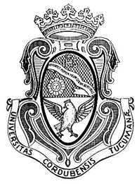

# Universidad Nacional de Córdoba

**Facultad de Ciencias Exactas, Físicas y Naturales**
**Cátedra Redes de Computadoras**

## Trabajo Práctico 6

</div>

**Alumnos:**

| Nombres                       | DNI        |
|:-----------------------------:|:----------:|
| Monetti, Francisco            | 46590584   |
| Toranzo, Hernan               | 44345504   |
| Silva, Jonathan Ariel         | 42641133   |
| Barron Saez, Lautaro          | 44909179   |
| Hernandez, Gonzalo Nicolas    | 42246081   |
| Michaud, Facundo              | 47302808   |

Octubre 2026

---

## Índice

1. [Parte 1: Taller de armado y verificación de cables Cat5/Cat5e bajo estándar T568A/B.](#parte-1-taller-de-armado-y-verificación-de-cables-cat5cat5e-bajo-estándar-t568ab)
   - [1) Pasos para el crimpado de un cable bajo la norma T568A/B DERECHO](#1-pasos-para-el-crimpado-de-un-cable-bajo-la-norma-t568ab-derecho)
   - [2) Armado del cable de nuestro grupo](#2-armado-del-cable-de-nuestro-grupo)
   - [3 y 4) Intercambio de cables con otro grupo](#3-y-4-intercambio-de-cables-con-otro-grupo)
2. [Desarrollar un pequeño servidor](#desarrollar-un-pequeño-servidor)
   - [1) Inicio del Servidor y Transferencia de Archivos](#1-inicio-del-servidor-y-transferencia-de-archivos)
   - [2) Captura y Análisis de Tráfico](#2-captura-y-análisis-de-tráfico)

---

## Consignas

## Parte 1: Taller de armado y verificación de cables Cat5/Cat5e bajo estándar T568A/B

### 1) Pasos para el crimpado de un cable bajo la norma T568A/B DERECHO

Las normas **T568A** y **T568B** corresponden a las dos configuraciones normalizadas de terminación y asignación de pines para cables de par trenzado de cuatro pares. Ambos estándares provienen de la norma **ANSI/TIA-568** y definen el orden en que deben colocarse los 8 cables de par trenzado en el conector **RJ-45** (mirando el conector con la pestaña hacia abajo y los contactos dorados hacia arriba, de izquierda a derecha). La única diferencia entre **T568A** y **T568B** se da en que se intercambian de posición los pares verde y naranja (los pares azul y marrón quedan en las mismas posiciones en ambas normas).
El hecho que el cable de red sea derecho hace referencia a usar el mismo estándar de terminación en ambos extremos (es decir, extremo 1 con **T568A** y extremo 2 con **T568A**, o bien ambos extremos con **T568B**). De esta forma, el pin 1 de un extremo viaja directamente al pin 1 del otro, el pin 2 al pin 2, y así sucesivamente.

En nuestro grupo hemos decidido usar la norma T568B. La secuencia de colores para el crimpado del cable es la siguiente:

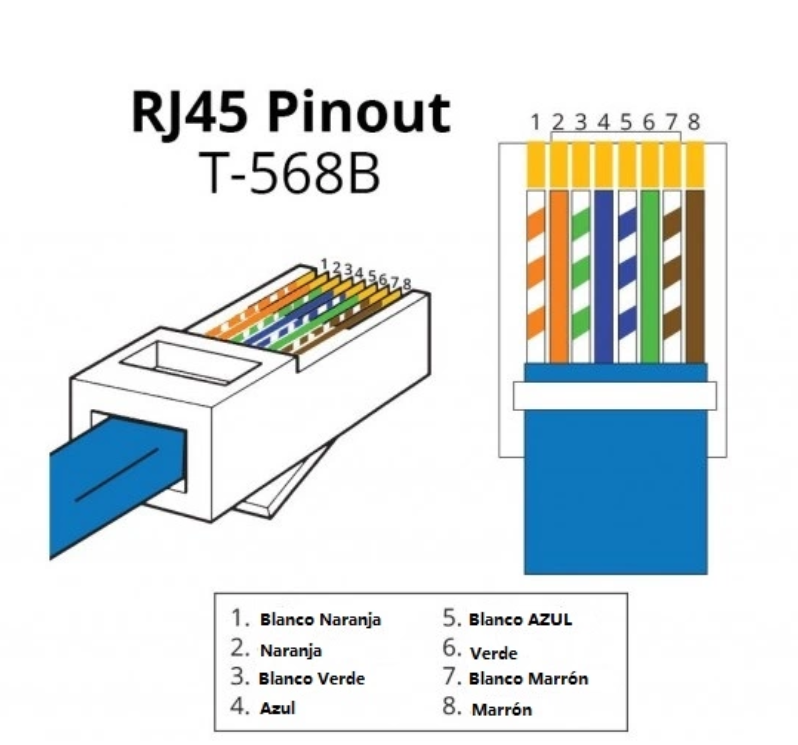

Los pasos para el crimpado son (adjuntaremos imágenes obtenidas de internet, puesto que nos hemos olvidado de sacar fotos del paso a paso):

- Teniendo un cable UTP, cortamos un tramo de entre 1 a 1.5 metros. 
- Hacemos uso de un pelacables para cortar el protector con un margen suficiente para manipular luego los pares (aproximadamente unos 3 cm).

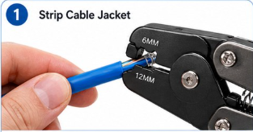

- Separar los 4 pares trenzados y destrenzarlos hasta el inicio del protector. Aplanar los pares con los dedos y ordenarlos de izquierda a derecha de acuerdo a la norma elegida (imágenes ilustrativas).

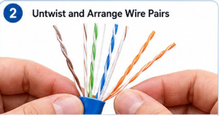
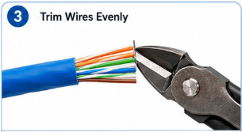

- En caso de quedar "hilos" sobresalientes, recortarlos.
- Con los pares aplanados y ordenados, los colocamos cuidadosamente (comprobando que ninguno se doble o cruce) dentro del conector **RJ-45**, con la pestaña plástica hacia abajo y los contactos metálicos dorados mirando hacia arriba. Debemos asegurarnos de empujarlos hasta que estos toquen el frente del **RJ-45**.

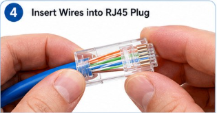

- Usando una crimpeadora, colocamos el conector en la cavidad 8P de la misma y apretamos firmemente hasta que el conector quede completamente crimpeado (Las cuchillas doradas perforan el protector de los pares y la pestaña plástica los apretará).

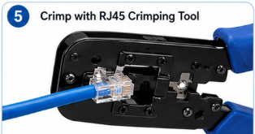

- Comprobar visualmente que los cables estén bien alineados.
- Repetir los pasos con el otro extremo del cable aplicando la misma norma (T568B en nuestro caso).
- Ahora, para verificar que el cable esté correctamente crimpeado, utilizamos un Tester de cable Ethernet. El Master debería encender las luces secuencialmente para indicar que cada uno de los pines funciona correctamente.

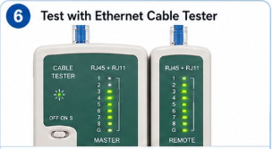

### 2) Armado del cable de nuestro grupo

Respetando los pasos anteriores, los resultados obtenidos fueron los siguientes:

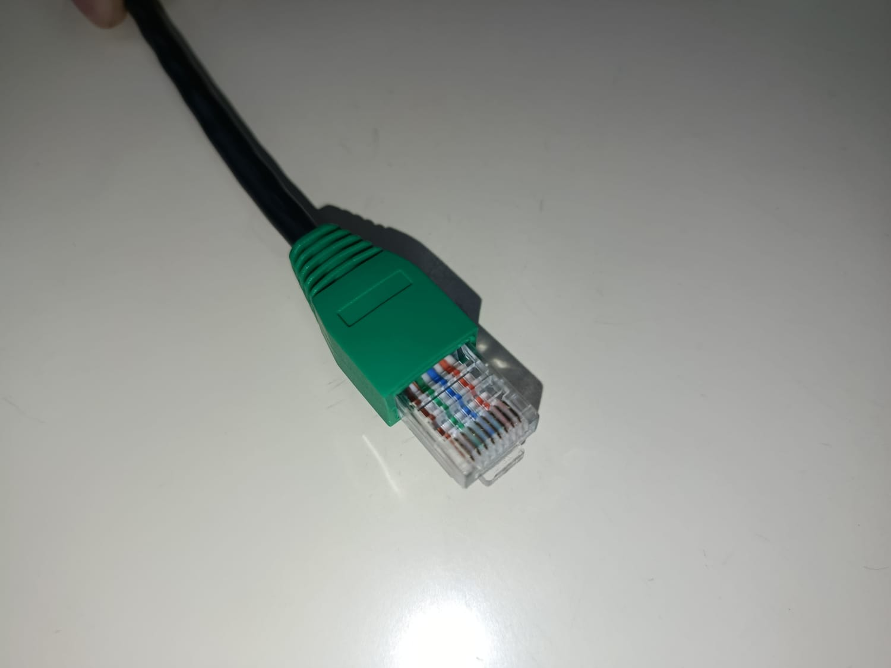
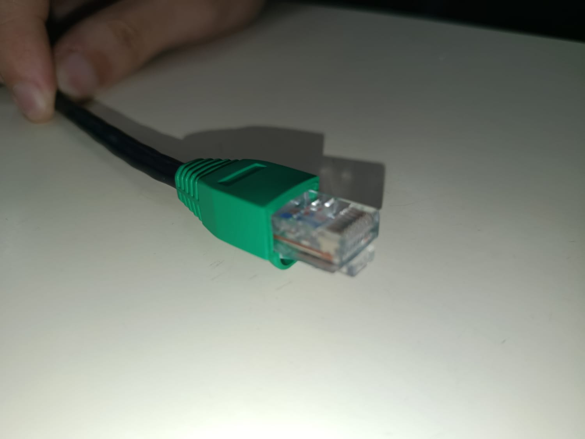
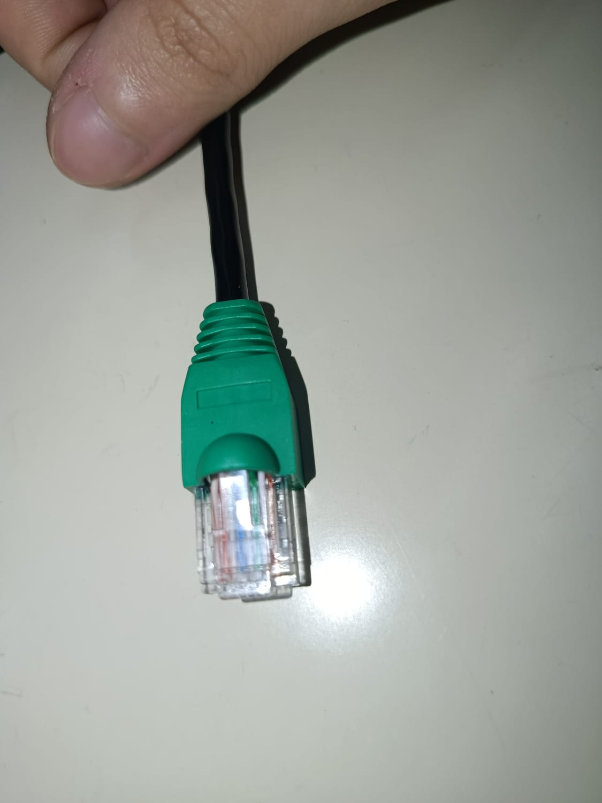

### 3 y 4) Intercambio de cables con otro grupo

El grupo **Bitless** intercambió los cables armados con el grupo **Los simuLANdores**. A continuación brindamos unas imágenes de lo realizado por ellos.

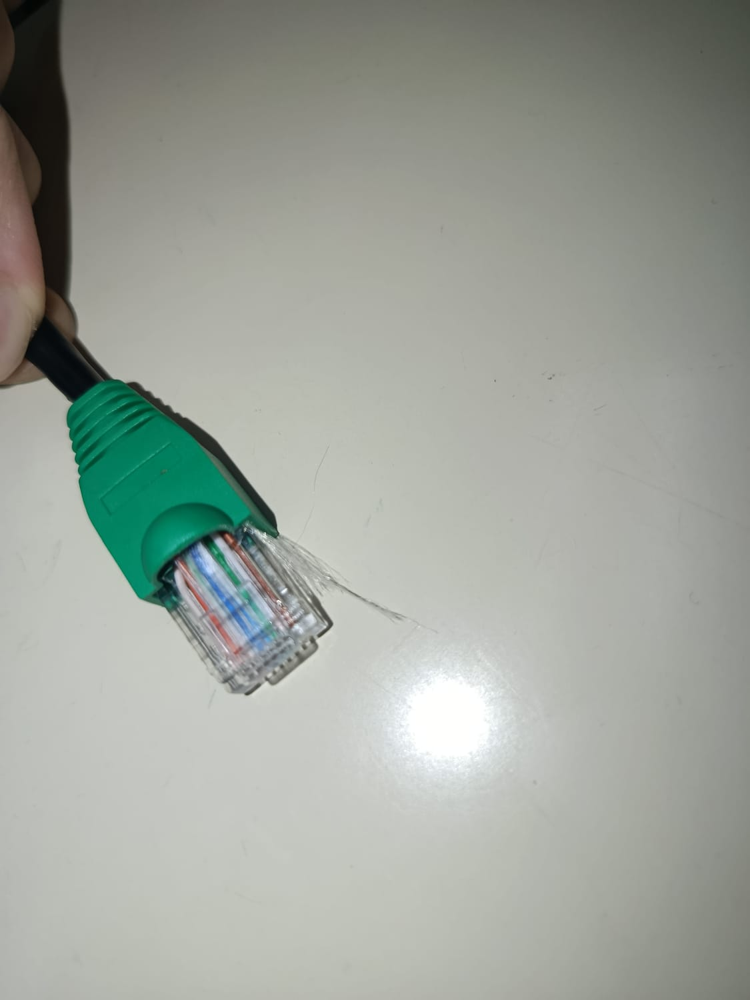
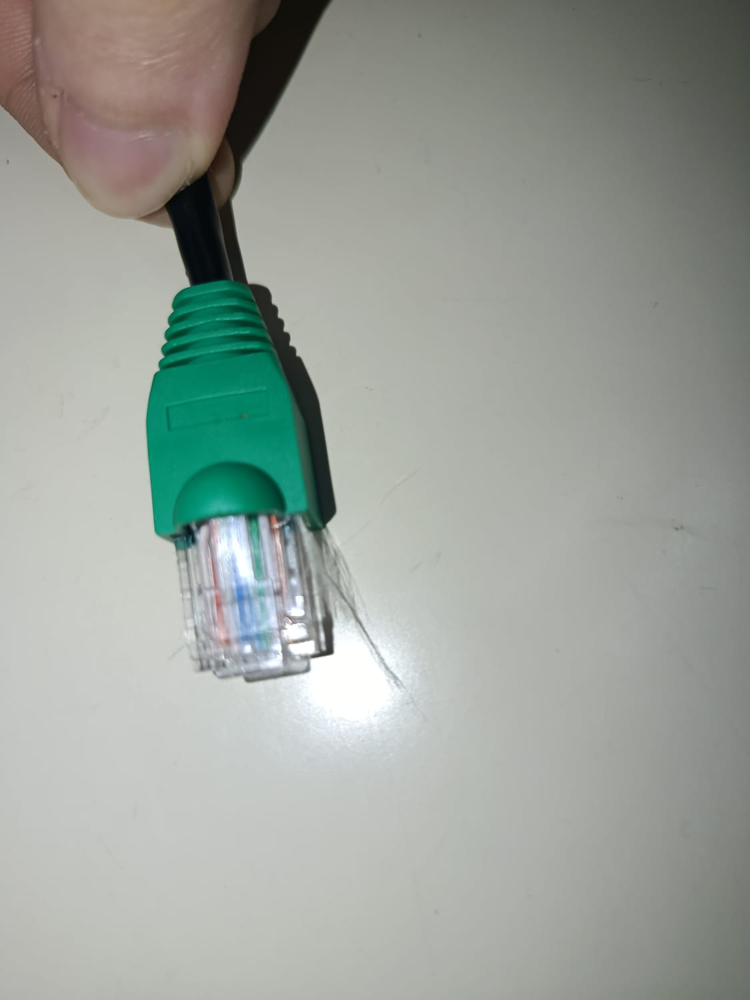

Como podemos observar a primera vista, ni siquiera han retirado el **hilo de nylon** al realizar el armado del cable. Al menos podría haber habido un esfuerzo en cuanto a ocultarlo de alguna manera, pero ha quedado sobresaliente como si hubiera sido lo que se buscara resaltar. Nosotros, como integrantes del grupo **Bitless**, si buscáramos **comprar** un **cable Ethernet**, definitivamente **no elegiríamos uno con estos defectos visuales**. Es por ello que adjuntamos la siguiente imagen para indicar el cuidado que deberían haber tenido a la hora de realizar su armado.

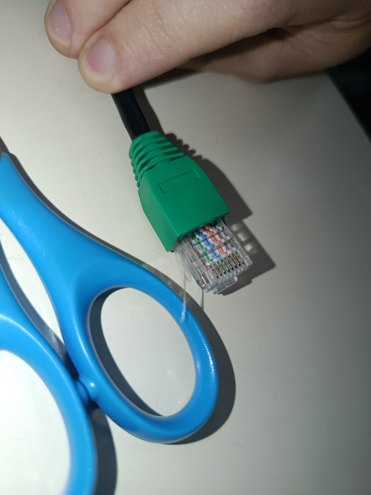

A su vez, para comprobar que su cable funcionara correctamente, utilizamos el **tester de cables Ethernet**. Su cable funcionaba correctamente, por lo que a nivel funcional estaba bien hecho. Sin embargo, el mismo **hilo de nylon** que mencionamos anteriormente **fue una molestia** a la hora de hacer la prueba, pues teníamos que **apartarlo** para **asegurarnos de que no se introdujera en el tester**. Lamentablemente, nos olvidamos de tomar foto del proceso, por lo que continuación adjuntamos una imagen generada con IA de cómo fue aproximadamente.

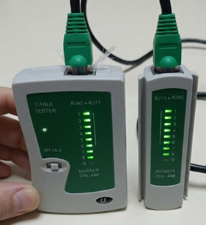

Aparte de ese **desperfecto imperdonable** que su cable tenía, los cables se veían bien alineados y ordenados dentro del conector, por lo que ese proceso se había realizado correctamente.

---
## Levantar y testear una LAN
Configuracion manual de la interfaz de red para la actividad

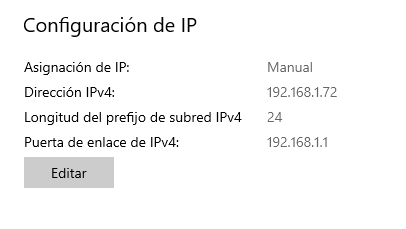

### justificacion de las direcciones elegidas

seleccionamos la IP 192.168.1.72 con la mascara de subred 255.255.255.0 porque pertenecen a un rango de direcciones IPv4 privadas ideales para redes de area local (LAN) pequeñas sin salida directa a internet, esto tiene sentido porque la computadora del otro grupo se encontraba en la misma red (192.168.1.100), compartiendo el mismo identificador de red permitiendo la comunicacion atraves del switch fisico sin necesitar un router externo


### Establecimiento del receptor UDP y envio de mensajes intergrupales


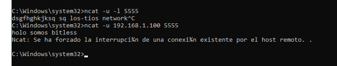

### 5) Preguntas y respuestas sobre UDP

#### a)¿Se observa algún procedimiento de establecimiento de conexión antes de enviar los datos?


 no, no se observa ningun procedimiento de conexion, la comunicacion udp no es orientada a conexion, osea que los datagramas se envian directamente desde la fuente hacia el destino sin negociar estados previos, intercambiar numeros de secuencia ni sincronizar parametros entre los extremos

#### b)¿Existe algún mecanismo de confirmación de recepción equivalente a los ACK de TCP?


No a nivel del protocolo UDP, por su caracteristica de no ser confiable, no incorpora mecanismos nativos de control de flujo, retransmision de paquetes perdidos ni acuses de recibo (ACK) 


#### c)¿Qué ocurre si se envían mensajes mientras el receptor UDP no está ejecutándose? 


si no se esta ejecutando un receptor UDP dependiendo de como se configure el SO del destino, el host receptor suele responder con un mensaje de control ICMP port unreachable. Mientras tanto en el emisor, los datagramas se transmiten de todas formas y la terminal no se entera de que nadie lo recibio 


#### d)¿UDP garantiza que los mensajes lleguen en el mismo orden en que fueron enviados?

No, cada datagrama se procesa y enruta de manera independiente a traves de la red. Osea que los paquetes pueden tomar rutas distintas, sufrir retardos variables o congestiones puntuales, lo cual hace que lleguen en un orden diferente al que fueron emitidos.

#### e) ¿Qué aplicaciones reales utilizan UDP y por qué? 

las aplicaciones reales que utilizan UDP son; 
   * streaming de video/audio en tiempo real
   * juegos en linea multijugador 
   * DNS (Domain Name System) 
   * protocolos de red y administracion local(DHCP,TFTO,SNMP)

    En estas aplicaiones se utiliza UDP ya que priorizan la velocidad y baja latencia ademas de que la perdida de paquetes es preferible a sufrir retrasos por retransmisiones y el control de flujo de TCP
---

## Desarrollar un pequeño servidor

Configuración inicial:

IP Computadora 1 (Servidor): 192.168.1.72

IP Computadora 2 (Cliente): 192.168.1.64

`nota: este punto fue realizado en un hogar conectando una notebook y una PC a la red doméstica.`

### 1)  Inicio del Servidor y Transferencia de Archivos:

Para empezar, se creó un directorio con archivos de prueba y se levantó un servidor en la Computadora 1 ejecutando el comando `python3 -m http.server 8000`.


Luego, desde la Computadora 2, se accedió a la dirección del servidor a través de un navegador web, visualizando el índice del directorio alojado en el puerto 8000.


Se puede observar que durante esta primera etapa de navegación web se realizaron las siguientes peticiones HTTP al servidor para listar el directorio y visualizar/descargar el contenido:

`GET /` Carga del índice del directorio, respuesta 200 OK.

`GET /favicon.ico` Petición automática del navegador, respuesta 404 File not found.

`GET /yo.png` Descarga de imagen, respuesta 200 OK.

`GET /TP6_Redes.txt` Descarga de archivo de texto, respuesta 200 OK.

`GET /RC - TP N6.pdf` Descarga de documento PDF, respuesta 200 OK.

Finalmente, se realizó una nueva transferencia de archivos, pero esta vez solicitando un recurso directamente desde la terminal del cliente utilizando la herramienta curl:

```
curl -O http://192.168.1.72:8000/yo.png
```


### 2) Captura y Análisis de Tráfico:

Durante todo el proceso de transferencia de los archivos (tanto vía navegador como por consola), se capturó el tráfico en la interfaz de red de la Computadora 2 (wlan0), aplicando un filtro para aislar las comunicaciones salientes y entrantes en el puerto 8000.


Al analizar los paquetes capturados en Wireshark, podemos ver:

TCP: Al inicio de cada solicitud, el establecimiento de una conexión mediante el Three-way handshake de TCP.

HTTP: Una vez establecida la conexión en la capa de transporte, fluye el tráfico de aplicación. El cliente realiza peticiones solicitando los recursos con el método GET, por ejemplo, `GET /TP6_Redes.txt HTTP/1.1` y las correspondientes respuestas del servidor. Estas respuestas incluyen un código de estado, siendo `200 OK` cuando se entregó el recurso con éxito, o `404 File not found` cuando el recurso no existía como sucedió con el ícono del navegador.

Podemos observar además que, al utilizar el protocolo HTTP estándar, la transferencia de los archivos y los encabezados se realiza en texto plano y puede leerse directamente con Wireshark.