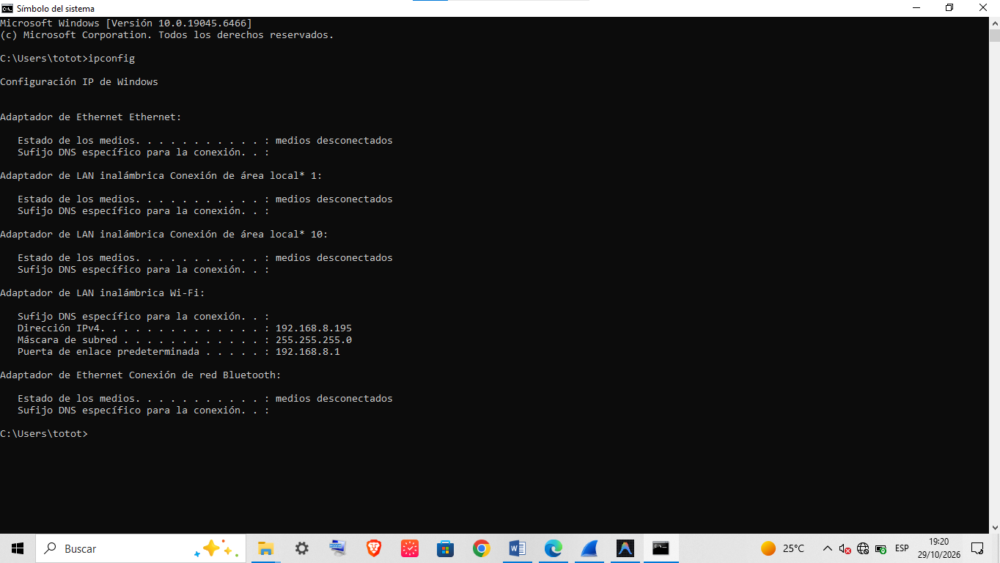
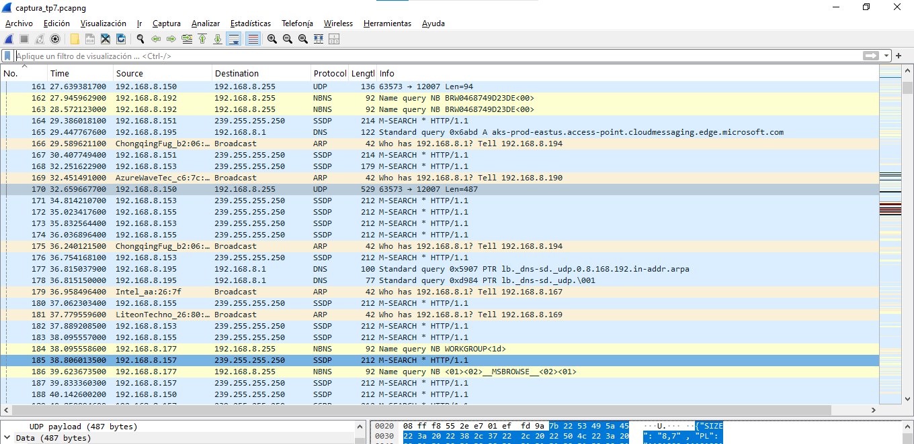
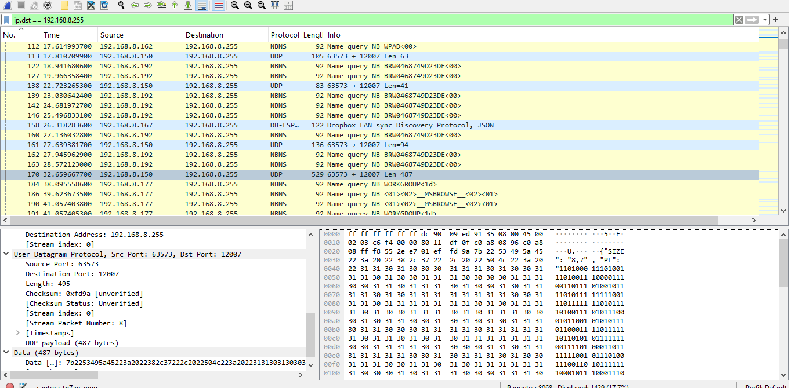
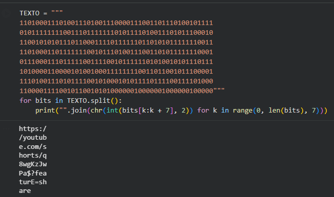
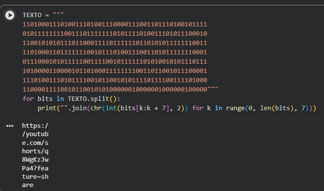
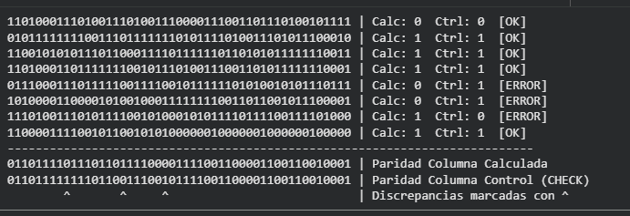

<div align="center">


# Universidad Nacional de Córdoba

**Facultad de Ciencias Exactas, Físicas y Naturales**
**Cátedra Redes de Computadoras**

## Trabajo Práctico 7

</div>

**Alumnos:**

| Nombres                       | DNI        |
|:-----------------------------:|:----------:|
| Monetti, Francisco            | 46590584   |
| Toranzo, Hernan               | 44345504   |
| Silva, Jonathan Ariel         | 42641133   |
| Barron Saez, Lautaro          | 44909179   |
| Hernandez, Gonzalo Nicolas    | 42246081   |
| Michaud, Facundo              | 47302808   |

Octubre 2026

---

## Índice

- [Parte Práctica](#parte-práctica)
  - [1) Averiguar nuestra IP y máscara](#1-averiguar-nuestra-ip-y-máscara)
  - [2) Captura de tráfico en Wireshark](#2-captura-de-tráfico-en-wireshark)
  - [3) Análisis de la estructura del mensaje](#3-análisis-de-la-estructura-del-mensaje)
  - [4) Verificar la integridad del mensaje](#4-verificar-la-integridad-del-mensaje)
  - [5) Ubicar y corregir los errores](#5-ubicar-y-corregir-los-errores)
  - [6) Decodificar el mensaje corregido](#6-decodificar-el-mensaje-corregido)
  - [7) Comparar paridades con script propio](#7-comparar-paridades-con-script-propio)
- [Reflexiones e investigación](#reflexiones-e-investigación)
  - [1) Errores en dos bits y daño en un bit de control](#1-errores-en-dos-bits-y-daño-en-un-bit-de-control)
  - [2) Contexto en el mensaje](#2-contexto-en-el-mensaje)
  - [3) Confirmar la corrección](#3-confirmar-la-corrección)
  - [4) Técnica de corrección Hamming (7,4)](#4-técnica-de-corrección-hamming-74)

---

## Parte Práctica


### 1) Averiguar nuestra IP y máscara

Mediante el comando `ipconfig` (o `ip addr`), identificamos los parámetros de red asignados por DHCP en la interfaz Wi-Fi:



* **Dirección IP asignada:** `192.168.8.195`
* **Máscara de subred:** `255.255.255.0` (`/24`)
* **Dirección IP de broadcast:** `192.168.8.255` (calculada aplicando la máscara sobre la subred)
* **Dirección MAC de broadcast:** `ff:ff:ff:ff:ff:ff`

### 2) Captura de tráfico en Wireshark

Iniciamos una captura en Wireshark sobre la interfaz Wi-Fi durante más de 2 minutos para monitorear el tráfico de la red del laboratorio:



Durante la captura observamos que la computadora transmisora emitía periódicamente (aproximadamente cada 30 segundos) paquetes UDP dirigidos a la dirección de broadcast `192.168.8.255`. Al filtrar estos paquetes, se identificaron las tramas que transportaban la carga útil del desafío.

### 3) Análisis de la estructura del mensaje

Inspeccionando el contenido de los paquetes capturados, identificamos que la carga útil viaja en formato **JSON**:



El mensaje contiene los siguientes campos:

* **`SIZE` (`"8,7"`):** Define las dimensiones de la matriz bidimensional. Indica **8 filas** y **7 caracteres ASCII** por fila. Dado que cada carácter se codifica en 7 bits, cada fila posee $7 \times 7 = 49$ bits, conformando una matriz total de **8 filas por 49 columnas** (392 bits de datos).
* **`PL` (Payload):** Cadena de caracteres ASCII formada por `'0'` y `'1'` que representa el mensaje codificado en binario (392 bits en total).
* **`CHECK` (Bits de control):** Cadena de 57 bits de paridad par calculados por el emisor:
  * Los primeros **8 bits** corresponden a la paridad par de cada una de las 8 filas.
  * Los **49 bits** restantes corresponden a la paridad par de cada una de las 49 columnas.

**Interpretación de los datos:**  
Para validar y reconstruir el mensaje, se debe dividir el payload `PL` en 8 bloques de 49 bits cada uno para formar la matriz, calcular la paridad par de cada fila y columna, y compararla con el campo `CHECK`. Aquellas filas y columnas donde no coincidan indicarán el síndrome de error para localizar e invertir los bits dañados.
  

### 4) Verificar la integridad del mensaje

Teniendo en cuenta que el mensaje recibido corresponde al **1° Payload** y que este en el campo `SIZE` nos indica que debemos armar una matriz 8x7 (8 filas, 7 columnas) con el mismo, organizándolo e ingresándolo en **decodificar_mensaje.py** se observa lo siguiente (prueba realizada en **Colab**):



Reorganizando el **Payload**, lo obtenido es: **https://youtube.com/shorts/q8wgKzJwPa$?featurE=share**, un enlace que apunta a Youtube pero parece estar erróneo.

Para comprobar esto, utilizamos el archivo **paridad.py**:


De acuerdo a dicho script, la paridad obtenida es **01110011 0110111101110110111100001111001100001100110010001** (La separación corresponde a la paridad de fila y la paridad de columna). Mientras que los bits de control son **01111101 0110111111110110011100101111001100001100110010001**. Colocando ambos juntos para comparar:

01110011 0110111101110110111100001111001100001100110010001 -> **Bits de paridad calculados**  
01111101 0110111111110110011100101111001100001100110010001 -> **Bits de control recibidos**

Comparando ambos, vemos qué filas y qué columnas fallan (el síndrome):
- **Filas que fallan:** Fila 4, Fila 5 y Fila 6.
- **Columnas que fallan:** Columna 8, Columna 16 y Columna 22.

### 5) Ubicar y corregir los errores

Los errores encontrados en los cruces de esas filas y columnas son los siguientes (teniendo en cuenta que contamos las filas y columnas partiendo desde 0):
- **Fila 4, columna 8** -> Hay un **1**, debería ser un **0**.
- **Fila 5, columna 16** -> Hay un **0**, debería ser un **1**.
- **Fila 6, columna 22** -> Hay un **0**, debería ser un **1**.

Cambiando esos bits del **Payload** obtenido, el resultado es el siguiente:

```text
1101000111010011101001110000111001101110100101111
0101111111100111011111110101111010011101011100010
1100101010111011000111101111110110101011111110011
1101000110111111100101110100111001101011111110001
0111000101011111001111001011111101010010101110111
1010000110000101101000111111110011011001011100001
1110100111010111100101100101011110111100111101000
1100001111001011001010100000010000001000000100000
```

### 6) Decodificar el mensaje corregido

Con los datos ya corregidos armamos el archivo de texto y, colocándolo nuevamente en el **script de decodificación**:



Lo obtenido es, armando bien el link: **https://youtube.com/shorts/q8WgKzJwPa4?feature=share**. Este nos lleva al video correspondiente al **premio 1**:


Acá se nota lo que advertía la consigna de que un mensaje que "se lee bien" no es necesariamente correcto: al principio parecía que decía YouTube pero con caracteres cambiados como `Pa$` o `featurE` no funcionaba, y recién al corregir los bits con la paridad pudimos llegar al video real.

### 7) Comparar paridades con script propio

Como `paridad.py` solamente calcula las paridades y no las compara con las recibidas en el paquete, nos basamos en ese script para armar uno propio (`comparar_paridad.py`) que tome el archivo del payload (con `"SIZE"`, `"PL"` y `"CHECK"`) y haga la comparación de forma automática:

```python
import sys
import json

ruta = sys.argv[1] if len(sys.argv) > 1 else "payload1.json"

with open(ruta, encoding="utf-8") as f:
    data = json.load(f)

filas_n, cols_chars = map(int, data["SIZE"].split(","))
cols_bits = cols_chars * 7
pl = data["PL"]
check = data["CHECK"]

# Separamos el payload en filas de bits
filas = [pl[i * cols_bits:(i + 1) * cols_bits] for i in range(filas_n)]
check_filas = check[:filas_n]
check_cols = check[filas_n:]

# 1. Comparar paridad de cada fila
for i, fila in enumerate(filas):
    calc = fila.count("1") % 2
    ctrl = int(check_filas[i])
    estado = "[OK]" if calc == ctrl else "[ERROR]"
    print(f"{fila} | Calc: {calc} Ctrl: {ctrl} {estado}")

print("-" * 80)

# 2. Comparar paridad de cada columna
calc_cols = "".join(str(sum(fila[j] == "1" for fila in filas) % 2) for j in range(cols_bits))
print(f"{calc_cols} | Paridad Columna Calculada")
print(f"{check_cols} | Paridad Columna Control (CHECK)")

# 3. Marcar las columnas con discrepancias
discrepancias = "".join("^" if calc_cols[j] != check_cols[j] else " " for j in range(cols_bits))
print(f"{discrepancias} | Discrepancias marcadas con ^")
```

Al ejecutarlo, el resultado que obtuvimos es el siguiente:



Como se observa, el script compara automáticamente cada fila calculada contra el control marcando `[ERROR]` en las filas 4, 5 y 6, y abajo compara la paridad de columnas colocando el puntero `^` en las columnas 8, 16 y 22. De esta forma pudimos verificar y ubicar al instante los bits con error sin tener que revisar los 57 bits a mano uno por uno.

---

## Reflexiones e investigación

### 1) Errores en dos bits y daño en un bit de control

Si el mensaje tuviera errores en dos bits ubicados en filas y columnas distintas, por ejemplo en `(i1, j1)` y en `(i2, j2)` con `i1 ≠ i2` y `j1 ≠ j2`, cada uno alteraría la paridad de su fila y de su columna sin anularse con el otro, haciendo que fallen exactamente 2 filas (`i1` e `i2`) y 2 columnas (`j1` y `j2`). En ese caso, el receptor detectaría que hubo errores al ver las cuatro sumas de paridad alteradas, pero no podría corregirlos por la ambigüedad que se genera: entre esas dos filas y dos columnas hay cuatro cruces posibles (`(i1, j1)`, `(i1, j2)`, `(i2, j1)` y `(i2, j2)`), y tanto invertir el par `{(i1, j1), (i2, j2)}` como el par cruzado `{(i1, j2), (i2, j1)}` da el mismo síndrome, por lo que matemáticamente no se puede saber cuál de las dos combinaciones fue la que se dañó.

Por otro lado, si se dañara únicamente un bit de los de control y todos los bits de datos llegaran bien, fallaría solamente 1 fila y ninguna columna (si se alteró un bit de paridad de fila), o bien 1 columna y ninguna fila (si se alteró uno de columna). Como el fallo aparece en una sola dimensión y no hay intersección entre fila y columna, el receptor puede deducir que los datos llegaron intactos y que el error estuvo en ese bit de control.

### 2) Contexto en el mensaje

Cuando leemos un texto en castellano, es fácil identificar un error de tipeo o de transmisión porque el contexto y las reglas del idioma nos permiten anticipar qué iba en ese lugar. Sin embargo, ese criterio no sirve para datos como una contraseña, un número de cuenta bancaria o una dirección web ya que no existe un contexto ni reglas de lenguaje para adivinar qué carácter falta o cuál se alteró. Cada símbolo es arbitrario y exacto, un solo bit cambiado hace que la contraseña sea incorrecta, una transferencia vaya a otra cuenta o que el navegador intente conectarse a una dirección distinta o inexistente.

Frente a "leer y adivinar", el código de detección y corrección de errores aporta un método matemático automatizable que no depende de la interpretación de una persona. Al organizar los datos en una matriz y agregar bits de paridad par mediante una operación XOR para cada fila y cada columna, el receptor puede comprobar si los datos sufrieron alteraciones en el canal. Además de avisar con certeza si hubo un fallo simple, la paridad bidimensional permite cruzar la fila y la columna que no cierran (el síndrome) para ubicar la posición exacta del bit dañado e invertirlo. En una difusión como la del laboratorio, esto es importante porque nos permite reconstruir el mensaje original por nuestra cuenta sin necesidad de pedirle al transmisor que lo reenvíe.

### 3) Confirmar la corrección

Pudimos confirmar que la corrección fue correcta combinando la validación de las paridades con la prueba funcional del mensaje decodificado. En primer lugar, luego de detectar con nuestro script `comparar_paridad.py` que fallaban las filas 4, 5 y 6 y las columnas 8, 16 y 22 respecto del campo `"CHECK"`, invertimos los bits en las coordenadas (4, 8), (5, 16) y (6, 22). Al volver a calcular la paridad sobre la matriz corregida, verificamos que todas las filas y columnas pasaban a coincidir con los 57 bits de control recibidos, dejando el síndrome en cero.

En segundo lugar, armamos el archivo de texto con los datos corregidos y lo pasamos por `decodificar_mensaje.py` para traducir los bloques de 7 bits a ASCII, obteniendo el enlace `https://youtube.com/shorts/q8WgKzJwPa4?feature=share`. Como indica la guía, que un mensaje se lea bien no asegura que esté libre de errores: además de las fallas visibles en `Pa$` y `featurE`, el error en (4, 8) había cambiado la `W` del identificador por una `w` minúscula, algo imposible de notar a simple vista, sumado a que con tres filas y tres columnas en falla existe más de una combinación de cruces que satisface la paridad. Por eso, la confirmación definitiva fue probar la URL corregida en el navegador y comprobar que abría el video del premio 1.


### 4) Técnica de corrección Hamming (7,4)

El código de **Hamming (7,4)** es un código corrector de errores (con distancia mínima `d_min = 3`) que toma bloques de 4 bits de datos y les agrega 3 bits de paridad (`p1`, `p2`, `p3`), armando palabras de 7 bits `(b1 b2 b3 b4 b5 b6 b7)`. Las posiciones que son potencias de 2 (`1`, `2` y `4`) se usan para los bits de paridad (`p1`, `p2` y `p3`), mientras que las posiciones 3, 5, 6 y 7 llevan los bits de datos (`d3`, `d5`, `d6`, `d7`). En el emisor, cada bit de paridad se calcula con XOR (`⊕`) entre las posiciones cuyo número en binario tiene un `1` en ese bit: `p1 = d3 ⊕ d5 ⊕ d7` (posiciones 1, 3, 5 y 7), `p2 = d3 ⊕ d6 ⊕ d7` (posiciones 2, 3, 6 y 7) y `p3 = d5 ⊕ d6 ⊕ d7` (posiciones 4, 5, 6 y 7). Al recibir los 7 bits, el receptor vuelve a calcular `s1 = p1 ⊕ d3 ⊕ d5 ⊕ d7`, `s2 = p2 ⊕ d3 ⊕ d6 ⊕ d7` y `s3 = p3 ⊕ d5 ⊕ d6 ⊕ d7` para formar el síndrome en binario `S = (s3 s2 s1)₂`: si `S = 0` no hubo errores, y si es distinto de cero, su valor en decimal (de 1 a 7) indica directamente la posición del bit dañado (ya sea de datos o de paridad), por lo que solo hay que invertirlo para corregirlo.

Esta técnica es superior a la demostración del laboratorio porque, para empezar, trabaja a nivel de bits (*bit-wise*) en lugar de mandar cada `0` y `1` como un carácter ASCII de 7 bits. Además, mientras la paridad bidimensional solo garantiza corregir sin ambigüedad un único error en toda la matriz (y en el desafío nos obligó a verificar el texto decodificado para descartar otros cruces posibles), Hamming (7,4) separa el mensaje en bloques cortos de 7 bits y puede corregir 1 error por cada bloque. De esta forma, soporta hasta 98 errores repartidos en nuestro payload sin generar ambigüedad, corrige tanto bits de datos como de paridad y se puede ir procesando a medida que llegan los bloques sin esperar a tener toda la matriz.

Al aplicar Hamming (7,4) sobre la carga útil recuperada (`https://youtube.com/shorts/q8WgKzJwPa4?feature=share`, que con los 4 espacios de relleno de la matriz 8×7 suma 56 caracteres de 7 bits, es decir, **392 bits**), quedan exactamente **98 bloques** de 4 bits y se genera una secuencia codificada de **686 bits**. Por ejemplo, los primeros cuatro bits `1101` de la `'h'` (`1101000`) dan `p1 = 1 ⊕ 1 ⊕ 1 = 1`, `p2 = 1 ⊕ 0 ⊕ 1 = 0` y `p3 = 1 ⊕ 0 ⊕ 1 = 0`, formando `1010101`, mientras que el bloque siguiente `0001` forma `1101001`. Con esto, el paquete JSON listo para enviar y recuperar ante errores queda así:

```json
{
  "ENCODING": "Hamming(7,4)",
  "DATA_BITS": 392,
  "ENCODED_BITS": 686,
  "PL": "10101011101001101010110000111011010000111100000000010110110011000101100011001000111110110101111111111111110000110110011111111110110101111111100110000101100110011111000001100110101010101101000101100111100000111101100111111111110011010110101111111001011000011111011010100001100011111111111010101000101100011001011110010101010001111111111111010010001111110100101001011111111100001101111000110011111111101001010101010011001101100111010101000000001111000101010101010111010011111111001011011001100111100011001111100000001111101101000011110100101001011001001010011001010010100101101111111100001110101011101001111000000011110011001110011001001011001100000000011100001101001000000001010100000000"
}
```
