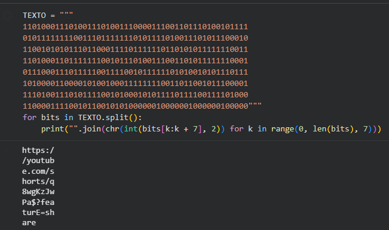
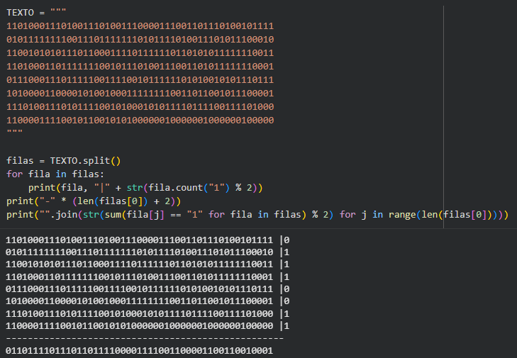
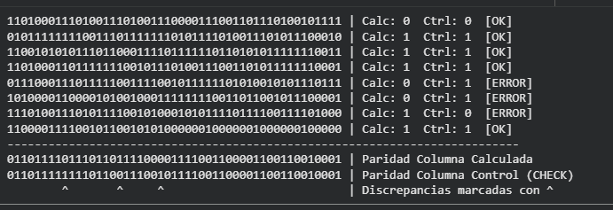
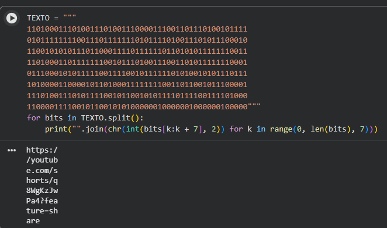
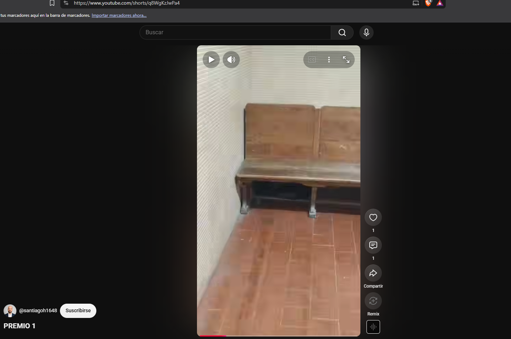

# Universidad Nacional de Córdoba

**Facultad de Ciencias Exactas, Físicas y Naturales**
**Cátedra Redes de Computadoras**

## Trabajo Práctico 7

**Alumnos:**

| Nombres                       | DNI        |
|:-----------------------------:|:----------:|
| Monetti, Francisco            | 46590584   |
| Toranzo, Hernan               | 44345504   |
| Silva, Jonathan Ariel         | 42641133   |
| Barron Saez, Lautaro          | 44909179   |
| Hernandez, Gonzalo Nicolas    | 42246081   |
| Michaud, Facundo              | 47302808   |

Octubre 2026

---

## Índice

- [Parte Práctica](#parte-práctica)
  - [4 y 5) Verificar la integridad del mensaje](#4-y-5-verificar-la-integridad-del-mensaje)

---

## Consignas

## Parte Práctica

### 4 y 5) Verificar la integridad del mensaje

Teniendo en cuenta que el mensaje recibido corresponde al **1° Payload** y que este en el campo `"SIZE"` nos indica que debemos armar una matriz 8x7 (8 filas, 7 columnas) con el mismo, organizándolo e ingresándolo en **decodificar_mensaje.py** se observa lo siguiente (prueba realizada en **Colab**):

Reorganizando el **Payload**, lo obtenido es: **https://youtube.com/shorts/q8wgKzJwPa$?featurE=share**, un enlace que apunta a Youtube pero parece estar erróneo.

Para comprobar esto, utilizamos el archivo **paridad.py**:

De acuerdo a dicho script, la paridad obtenida es **01110011 0110111101110110111100001111001100001100110010001** (La separación corresponde a la paridad de fila y la paridad de columna). Mientras que los bits de control son **01111101 0110111111110110011100101111001100001100110010001**. Colocando ambos juntos para comparar:

01110011 0110111101110110111100001111001100001100110010001 -> **Bits de paridad recibidos**
01111101 0110111111110110011100101111001100001100110010001 -> **Bits de control recibidos**

Utilizando un script realizado por nosotros mismos:

Los errores encontrados son los siguientes (teniendo en cuenta que contamos las filas y columnas partiendo desde 0):
- **Fila 4, columna 8** -> Hay un **1**, debería ser un **0**.
- **Fila 5, columna 16** -> Hay un **0**, debería ser un **1**.
- **Fila 6, columna 22** -> Hay un **0**, debería ser un **1**.

Cambiando esos bits del **Payload** obtenido, el resultado es el siguiente:

1101000111010011101001110000111001101110100101111
0101111111100111011111110101111010011101011100010
1100101010111011000111101111110110101011111110011
1101000110111111100101110100111001101011111110001
0111000101011111001111001011111101010010101110111
1010000110000101101000111111110011011001011100001
1110100111010111100101100101011110111100111101000
1100001111001011001010100000010000001000000100000

Colocándolo nuevamente en el **script de decodificación**:

Lo obtenido es, armando bien el link: https://youtube.com/shorts/q8WgKzJwPa4?feature=share. Este nos lleva al video correspondiente al **premio 1**:

