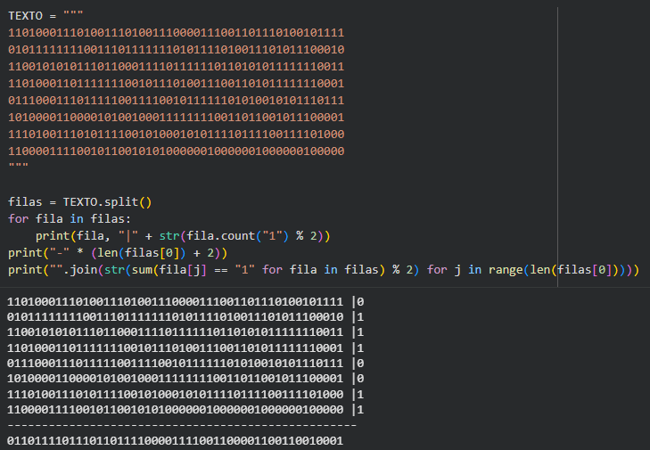

<div align="center">


# Universidad Nacional de Córdoba

**Facultad de Ciencias Exactas, Físicas y Naturales**
**Cátedra Redes de Computadoras**

## Trabajo Práctico 7

</div>

**Alumnos:**

| Nombres                       | DNI        |
|:-----------------------------:|:----------:|
| Monetti, Francisco            | 46590584   |
| Toranzo, Hernan               | 44345504   |
| Silva, Jonathan Ariel         | 42641133   |
| Barron Saez, Lautaro          | 44909179   |
| Hernandez, Gonzalo Nicolas    | 42246081   |
| Michaud, Facundo              | 47302808   |

Octubre 2026

---

## Índice

- [Parte Práctica](#parte-práctica)
  - [4) Verificar la integridad del mensaje](#4-verificar-la-integridad-del-mensaje)
  - [5) Ubicar y corregir los errores](#5-ubicar-y-corregir-los-errores)
  - [6) Decodificar el mensaje corregido](#6-decodificar-el-mensaje-corregido)
  - [7) Comparar paridades con script propio](#7-comparar-paridades-con-script-propio)
- [Reflexiones e investigación](#reflexiones-e-investigación)
  - [1) Errores en dos bits y daño en un bit de control](#1-errores-en-dos-bits-y-daño-en-un-bit-de-control)
  - [2) Contexto en el mensaje](#2-contexto-en-el-mensaje)
  - [3) Confirmar la corrección](#3-confirmar-la-corrección)
  - [4) Técnica de corrección Hamming (7,4)](#4-técnica-de-corrección-hamming-74)

---

## Consignas

## Parte Práctica

### 4) Verificar la integridad del mensaje

Teniendo en cuenta que el mensaje recibido corresponde al **1° Payload** y que este en el campo `"SIZE"` nos indica que debemos armar una matriz 8x7 (8 filas, 7 columnas) con el mismo, organizándolo e ingresándolo en **decodificar_mensaje.py** se observa lo siguiente (prueba realizada en **Colab**):


Reorganizando el **Payload**, lo obtenido es: **https://youtube.com/shorts/q8wgKzJwPa$?featurE=share**, un enlace que apunta a Youtube pero parece estar erróneo.

Para comprobar esto, utilizamos el archivo **paridad.py**:



De acuerdo a dicho script, la paridad obtenida es **01110011 0110111101110110111100001111001100001100110010001** (La separación corresponde a la paridad de fila y la paridad de columna). Mientras que los bits de control son **01111101 0110111111110110011100101111001100001100110010001**. Colocando ambos juntos para comparar:

01110011 0110111101110110111100001111001100001100110010001 -> **Bits de paridad calculados**  
01111101 0110111111110110011100101111001100001100110010001 -> **Bits de control recibidos**

Comparando ambos, vemos qué filas y qué columnas fallan (el síndrome):
- **Filas que fallan:** Fila 4, Fila 5 y Fila 6.
- **Columnas que fallan:** Columna 8, Columna 16 y Columna 22.

### 5) Ubicar y corregir los errores

Los errores encontrados en los cruces de esas filas y columnas son los siguientes (teniendo en cuenta que contamos las filas y columnas partiendo desde 0):
- **Fila 4, columna 8** -> Hay un **1**, debería ser un **0**.
- **Fila 5, columna 16** -> Hay un **0**, debería ser un **1**.
- **Fila 6, columna 22** -> Hay un **0**, debería ser un **1**.

Cambiando esos bits del **Payload** obtenido, el resultado es el siguiente:

```text
1101000111010011101001110000111001101110100101111
0101111111100111011111110101111010011101011100010
1100101010111011000111101111110110101011111110011
1101000110111111100101110100111001101011111110001
0111000101011111001111001011111101010010101110111
1010000110000101101000111111110011011001011100001
1110100111010111100101100101011110111100111101000
1100001111001011001010100000010000001000000100000
```

### 6) Decodificar el mensaje corregido

Con los datos ya corregidos armamos el archivo de texto y, colocándolo nuevamente en el **script de decodificación**:


Lo obtenido es, armando bien el link: **https://youtube.com/shorts/q8WgKzJwPa4?feature=share**. Este nos lleva al video correspondiente al **premio 1**:


Acá se nota lo que advertía la consigna de que un mensaje que "se lee bien" no es necesariamente correcto: al principio parecía que decía YouTube pero con caracteres cambiados como `Pa$` o `featurE` no funcionaba, y recién al corregir los bits con la paridad pudimos llegar al video real.

### 7) Comparar paridades con script propio

Como `paridad.py` solamente calcula las paridades y no las compara con las recibidas en el paquete, nos basamos en ese script para armar uno propio (`comparar_paridad.py`) que tome el archivo del payload (con `"SIZE"`, `"PL"` y `"CHECK"`) y haga la comparación de forma automática:

```python
import sys
import json

ruta = sys.argv[1] if len(sys.argv) > 1 else "payload1.json"

with open(ruta, encoding="utf-8") as f:
    data = json.load(f)

filas_n, cols_chars = map(int, data["SIZE"].split(","))
cols_bits = cols_chars * 7
pl = data["PL"]
check = data["CHECK"]

# Separamos el payload en filas de bits
filas = [pl[i * cols_bits:(i + 1) * cols_bits] for i in range(filas_n)]
check_filas = check[:filas_n]
check_cols = check[filas_n:]

# 1. Comparar paridad de cada fila
for i, fila in enumerate(filas):
    calc = fila.count("1") % 2
    ctrl = int(check_filas[i])
    estado = "[OK]" if calc == ctrl else "[ERROR]"
    print(f"{fila} | Calc: {calc} Ctrl: {ctrl} {estado}")

print("-" * 80)

# 2. Comparar paridad de cada columna
calc_cols = "".join(str(sum(fila[j] == "1" for fila in filas) % 2) for j in range(cols_bits))
print(f"{calc_cols} | Paridad Columna Calculada")
print(f"{check_cols} | Paridad Columna Control (CHECK)")

# 3. Marcar las columnas con discrepancias
discrepancias = "".join("^" if calc_cols[j] != check_cols[j] else " " for j in range(cols_bits))
print(f"{discrepancias} | Discrepancias marcadas con ^")
```

Al ejecutarlo, el resultado que obtuvimos es el siguiente:


Como se observa, el script compara automáticamente cada fila calculada contra el control marcando `[ERROR]` en las filas 4, 5 y 6, y abajo compara la paridad de columnas colocando el puntero `^` en las columnas 8, 16 y 22. De esta forma pudimos verificar y ubicar al instante los bits con error sin tener que revisar los 57 bits a mano uno por uno.

---

## Reflexiones e investigación

### 1) Errores en dos bits y daño en un bit de control

Si el mensaje sufriera errores en dos bits ubicados en filas y columnas distintas —es decir, un bit alterado en `(i1, j1)` y otro en `(i2, j2)`, con `i1 ≠ i2` y `j1 ≠ j2`—, cada uno rompería la paridad de su propia fila y de su propia columna sin cancelarse entre sí, haciendo que en la comprobación fallen exactamente 2 filas (`i1` e `i2`) y 2 columnas (`j1` y `j2`). En ese escenario, el receptor detectaría con certeza la existencia de fallos al observar las cuatro sumas de paridad alteradas, pero no podría corregirlos de manera unívoca debido a la ambigüedad generada: entre esas dos filas y dos columnas existen cuatro intersecciones posibles —`(i1, j1)`, `(i1, j2)`, `(i2, j1)` y `(i2, j2)`—, y tanto invertir la pareja `{(i1, j1), (i2, j2)}` como la pareja cruzada `{(i1, j2), (i2, j1)}` produce exactamente el mismo síndrome, por lo que no hay forma matemática de determinar cuál de las dos combinaciones fue la dañada.

Por otro lado, si se dañara únicamente un bit de los de control (paridad) y ninguno de los bits de datos estuviera alterado, fallaría solamente 1 fila y 0 columnas (si el bit afectado pertenece a la paridad de filas), o bien solamente 1 columna y 0 filas (si pertenece a la paridad de columnas). Al manifestarse la discrepancia en una sola dimensión y no existir cruce entre fila y columna, el receptor determina que la matriz de datos se recibió intacta y que el único bit corrompido es justamente ese bit de control.

### 2) Contexto en el mensaje

Cuando leemos un texto en castellano, es fácil identificar un error de tipeo o de transmisión porque el contexto y las reglas del idioma nos permiten anticipar qué iba en ese lugar. Sin embargo, ese criterio no sirve para datos como una contraseña, un número de cuenta bancaria o una dirección web ya que no existe un contexto ni reglas de lenguaje para adivinar qué carácter falta o cuál se alteró. Cada símbolo es arbitrario y exacto, un solo bit cambiado hace que la contraseña sea incorrecta, una transferencia vaya a otra cuenta o que el navegador intente conectarse a una dirección distinta o inexistente.

Frente a "leer y adivinar", el código de detección y corrección de errores aporta un método matemático automatizable que no depende de la interpretación de una persona. Al organizar los datos en una matriz y agregar bits de paridad par mediante una operación XOR para cada fila y cada columna, el receptor puede comprobar si los datos sufrieron alteraciones en el canal. Además de avisar con certeza si hubo un fallo simple, la paridad bidimensional permite cruzar la fila y la columna que no cierran (el síndrome) para ubicar la posición exacta del bit dañado e invertirlo. En una difusión como la del laboratorio, esto es importante porque nos permite reconstruir el mensaje original por nuestra cuenta sin necesidad de pedirle al transmisor que lo reenvíe.

### 3) Confirmar la corrección

Pudimos confirmar que la corrección fue correcta combinando la validación de las paridades con la prueba funcional del mensaje decodificado. En primer lugar, luego de detectar con nuestro script `comparar_paridad.py` que fallaban las filas 4, 5 y 6 y las columnas 8, 16 y 22 respecto del campo `"CHECK"`, invertimos los bits en las coordenadas (4, 8), (5, 16) y (6, 22). Al volver a calcular la paridad sobre la matriz corregida, verificamos que todas las filas y columnas pasaban a coincidir con los 57 bits de control recibidos, dejando el síndrome en cero.

En segundo lugar, armamos el archivo de texto con los datos corregidos y lo pasamos por `decodificar_mensaje.py` para traducir los bloques de 7 bits a ASCII, obteniendo el enlace `https://youtube.com/shorts/q8WgKzJwPa4?feature=share`. Como indica la guía, que un mensaje se lea bien no asegura que esté libre de errores: además de las fallas visibles en `Pa$` y `featurE`, el error en (4, 8) había cambiado la `W` del identificador por una `w` minúscula, algo imposible de notar a simple vista, sumado a que con tres filas y tres columnas en falla existe más de una combinación de cruces que satisface la paridad. Por eso, la confirmación definitiva fue probar la URL corregida en el navegador y comprobar que abría el video del premio 1.

### 4) Técnica de corrección Hamming (7,4)

El código de **Hamming (7,4)** es un código lineal corrector de errores (con distancia mínima de Hamming `d_min = 3`) que toma bloques de 4 bits de datos y les añade 3 bits de paridad (`p1`, `p2`, `p3`), formando palabras código de 7 bits `(b1 b2 b3 b4 b5 b6 b7)`. Las posiciones que son potencias de 2 (`2⁰ = 1`, `2¹ = 2` y `2² = 4`) se reservan para los bits de paridad (`p1`, `p2` y `p3`, respectivamente), mientras que las posiciones 3, 5, 6 y 7 llevan los bits de datos (`d3`, `d5`, `d6`, `d7`). En el emisor, cada bit de paridad se calcula mediante XOR (`⊕`) sobre las posiciones cuyo índice binario tiene un `1` en el bit correspondiente: `p1 = d3 ⊕ d5 ⊕ d7` (cubre posiciones 1, 3, 5 y 7), `p2 = d3 ⊕ d6 ⊕ d7` (cubre 2, 3, 6 y 7) y `p3 = d5 ⊕ d6 ⊕ d7` (cubre 4, 5, 6 y 7). Al recibir los 7 bits, el receptor recalcula las comprobaciones `s1 = p1 ⊕ d3 ⊕ d5 ⊕ d7`, `s2 = p2 ⊕ d3 ⊕ d6 ⊕ d7` y `s3 = p3 ⊕ d5 ⊕ d6 ⊕ d7` para armar el síndrome binario `S = (s3 s2 s1)₂`: si `S = 0` no hubo errores, y si `S ≠ 0`, el valor decimal de `S` (de 1 a 7) indica la posición exacta del bit erróneo —sea de datos o de paridad—, bastando con invertirlo para recuperar la palabra original.

Esta técnica resulta superior a la demostración didáctica del laboratorio porque, en primer lugar, opera directamente a nivel *bit-wise* sobre el canal sin el enorme desperdicio de transmitir cada `0` y `1` como un carácter ASCII de 7 bits. Además, mientras la matriz bidimensional del laboratorio solo garantiza corregir sin ambigüedad un único error en toda la matriz (y en el desafío exigió validar el texto decodificado para descartar ambigüedades entre múltiples cruces posibles), Hamming (7,4) divide la información en bloques independientes de 7 bits y permite corregir 1 error por cada bloque, soportando hasta 98 errores distribuidos en nuestro payload sin ambigüedades, corrigiendo por igual bits de datos o de paridad y procesándose en flujo mediante simples compuertas XOR sin esperar a recibir la matriz completa.

Al aplicar Hamming (7,4) sobre la carga útil recuperada en el desafío (`https://youtube.com/shorts/q8WgKzJwPa4?feature=share`, que junto a los 4 espacios de relleno de la matriz 8×7 suma 56 caracteres ASCII de 7 bits, es decir, **392 bits**), se obtienen exactamente **98 bloques** de 4 bits sin necesidad de relleno adicional, generando un flujo codificado de **686 bits**. Por ejemplo, los primeros cuatro bits `1101` del carácter `'h'` (`1101000`) dan `p1 = 1 ⊕ 1 ⊕ 1 = 1`, `p2 = 1 ⊕ 0 ⊕ 1 = 0` y `p3 = 1 ⊕ 0 ⊕ 1 = 0`, formando la palabra `1010101`, mientras que el siguiente bloque `0001` genera `1101001`. De este modo, el paquete en formato JSON listo para transmitir por UDP y ser recuperado ante eventuales corrupciones en el canal queda conformado así:

```json
{
  "ENCODING": "Hamming(7,4)",
  "DATA_BITS": 392,
  "ENCODED_BITS": 686,
  "PL": "10101011101001101010110000111011010000111100000000010110110011000101100011001000111110110101111111111111110000110110011111111110110101111111100110000101100110011111000001100110101010101101000101100111100000111101100111111111110011010110101111111001011000011111011010100001100011111111111010101000101100011001011110010101010001111111111111010010001111110100101001011111111100001101111000110011111111101001010101010011001101100111010101000000001111000101010101010111010011111111001011011001100111100011001111100000001111101101000011110100101001011001001010011001010010100101101111111100001110101011101001111000000011110011001110011001001011001100000000011100001101001000000001010100000000"
}
```
